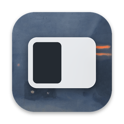
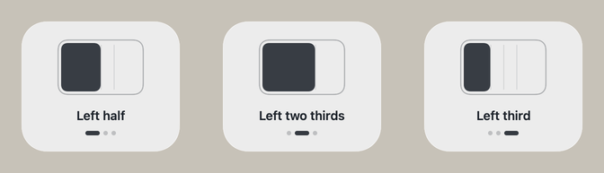
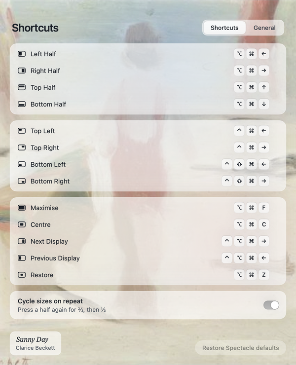

<p align="center"></p>

<h1 align="center">Snappl</h1>

<p align="center">Snap windows with the keyboard. Press again to cycle ½ → ⅔ → ⅓.<br>A small macOS menu bar app, made to replace Spectacle.</p>

---

Press **⌥⌘←** and the window fills the left half of the screen. Press it again for two thirds, and again for a third. The same works for every side and corner, and Snappl shows where the window went with a small pop-up in the middle of the screen.

<p align="center"></p>

## Download

1. Download the latest `Snappl-<version>.dmg` from [Releases](../../releases).
2. Open it and drag **Snappl** into **Applications**.
3. Open Snappl from Applications.

Snappl isn't signed by Apple yet, so the first time you open it macOS says it can't verify the app. Go to **System Settings → Privacy & Security**, scroll down, and click **Open Anyway** next to the message about Snappl. You only need to do this once.

Needs macOS 13 Ventura or later on an Apple silicon Mac. Intel Macs can [build from source](#build-from-source).

## First run

Snappl needs one permission: **Accessibility**, which is how macOS lets one app move another app's windows. Snappl only moves and resizes windows. It never reads what's inside them.

1. When macOS asks, click **Open System Settings**. (Or open **System Settings → Privacy & Security → Accessibility** yourself.)
2. Switch **Snappl** on.

Snappl's welcome window walks you through it, then has you try ⌥⌘← straight away. Snappl lives in the menu bar; click its icon for every snap and its shortcut, Settings and Quit.

If you use Spectacle or Rectangle, quit it first. They listen for the same shortcuts.

## Shortcuts

Spectacle's defaults, so your hands already know them. Change any of them in **Settings** (⌘, from the menu).

| Snap | Shortcut | Press again |
| --- | --- | --- |
| Left half | ⌥⌘← | ⅔, then ⅓ |
| Right half | ⌥⌘→ | ⅔, then ⅓ |
| Top half | ⌥⌘↑ | ⅔, then ⅓ |
| Bottom half | ⌥⌘↓ | ⅔, then ⅓ |
| Top left | ⌃⌘← | ⅔ wide, then ⅓ |
| Top right | ⌃⌘→ | ⅔ wide, then ⅓ |
| Bottom left | ⌃⇧⌘← | ⅔ wide, then ⅓ |
| Bottom right | ⌃⇧⌘→ | ⅔ wide, then ⅓ |
| Maximise | ⌥⌘F | |
| Centre | ⌥⌘C | |
| Next display | ⌃⌥⌘→ | |
| Previous display | ⌃⌥⌘← | |
| Restore (undo the first snap) | ⌥⌘Z | |

Snaps stay clear of the menu bar and the Dock.

## Settings

<p align="center"></p>

- **Shortcuts:** click a shortcut's keys, then press the new combination. It needs ⌘, ⌥ or ⌃. Esc cancels; Delete clears it. Hover a row and click ✕ to remove a shortcut. **Restore Spectacle defaults** puts them all back.
- **Cycle sizes on repeat:** switch off if you only want halves.
- **General:** light or dark appearance (follows your Mac unless you pick one), open at login, show or hide the snap pop-up, and check the Accessibility permission.

## Uninstall

Quit Snappl from its menu, drag it from Applications to the Bin, and remove it from **Privacy & Security → Accessibility**. Its settings live in `~/Library/Preferences/com.jessedavies.snappl.plist`.

## Build from source

You need macOS 13+ and Apple's Command Line Tools (`xcode-select --install`). Xcode itself isn't required.

```bash
git clone https://github.com/jessedavies/snappl.git
```

```bash
cd snappl && ./scripts/install.sh
```

That builds Snappl, installs it to `/Applications` and opens it. See [docs/DEVELOPING.md](docs/DEVELOPING.md) for signing, the project layout and the tools for working on the design.

## Credits

The paintings in Snappl's windows are by the Australian painter **Clarice Beckett** (1887–1935): *Sunny Day*, *Passing Trams*, *Moonrise, Beaumaris* and *Yarra Winter Night*. Her work is in the public domain. The images come from Wikimedia Commons.

Snappl owes its shortcuts and its cycling to [Spectacle](https://github.com/eczarny/spectacle), which is no longer maintained. Snappl isn't affiliated with it.

## Licence

[MIT](LICENSE).
